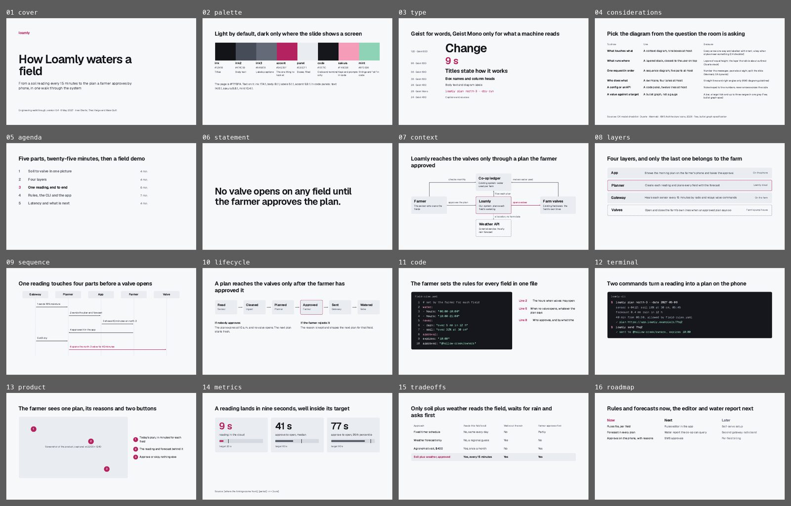

# Console

Product demos, engineering talks, architecture and security reviews, release walk-throughs. Light by default; the only dark surface is the code and terminal panel, where it matches the screen people know.



The same slides as a deck on claude.ai: https://claude.ai/artifact/Y5tL4hFxSFWbtFxnZ8jpZh (private to Eun until shared from its Share menu).

## The look

A cool light page, Geist for words and Geist Mono only for what a machine reads (code, commands, file names, ids). Boxes are filled one step darker than the page and never outlined, except the one box the slide is about (accent outline) and things someone else owns (dashed, no fill). No labels above titles, no rules, no page numbers. It borrows the C4 model’s context diagram and Linear’s and Vercel’s tight semibold type.

## Palette

| Token | Hex | Use | on bg | on panel | on code |
|---|---|---|---|---|---|
| bg | `#F7F8FA` | Every slide |  | 1.1 | 16.9 |
| panel | `#E9ECF1` | Boxes, filled and not outlined | 1.1 |  | 15.1 |
| ink | `#121418` | Titles and strong text | 17.4 | 15.6 | 1.0 |
| ink2 | `#474C59` | Body text and diagram labels | 8.1 | 7.2 | 2.1 |
| ink3 | `#646A78` | Labels, captions, lifelines | 5.1 | 4.6 | 3.3 |
| accent | `#B4235F` | The one thing to look at: an outline, a figure, a message | 5.9 | 5.3 | 2.9 |
| track | `#D5D9E0` | Bullet-graph tracks and lifelines | 1.3 | 1.2 | 12.7 |
| code | `#15171C` | Code and terminal panels only, the one dark surface | 16.9 | 15.1 |  |
| codeink | `#E6E8EE` | Text in code panels | 1.2 | 1.0 | 14.6 |
| codemuted | `#9AA0AE` | Comments, line numbers and output in code panels | 2.5 | 2.2 | 6.8 |
| sakura | `#F49CB8` | Keys and prompts in code panels | 1.9 | 1.7 | 8.8 |
| mint | `#8FD3B6` | Strings and “ok” lines in code panels | 1.6 | 1.5 | 10.4 |

Text needs 4.5:1 on its ground (3:1 at 44px and up); colours under 3:1 everywhere are for shapes and fills only.

## Type

Faces: Geist, Geist Mono (all Google Fonts, declared in `project/deck.json` `faces`). These are the only sizes; a slide should use three of them at most.

| Style | Size | Face | Weight | Line height | Tracking |
|---|---|---|---|---|---|
| display | 120px | Geist | 600 | 1.02 | -4px |
| figure | 96px | Geist | 600 | 1 | -2px |
| title | 56px | Geist | 600 | 1.18 | -1px |
| heading | 36px | Geist | 600 | 1.2 | -0.5px |
| small heading | 32px | Geist | 600 | 1.2 | -0.5px |
| body | 28px | Geist | 400 | 1.45 | 0 |
| code | 28px | Geist Mono | 400 | 1.5 | 0 |
| caption | 24px | Geist | 400 | 1.4 | 0 |

## Grid and spacing

1920 × 1080, `padding:128px`; a slide with a source gets `padding-bottom:160px`. Boxes pad 28 to 40px with 12px corners; diagram hosts are 1664px wide and 640 to 660px tall, with boxes on a regular pitch (the context diagram uses 360 × 176 boxes at lefts 0, 652, 1304 and tops 0, 232, 464; the sequence diagram five lifelines at a 332px pitch).

## Rules for this template

- The accent on one thing per slide: the outline of the box that matters, the figure the title names, the message in a sequence.
- Dark only for code and terminal panels; everything else is light.
- Every connector is labelled with what flows along it; labels sit 8px clear of the line. Lines exist only where they connect or carry time (connectors, lifelines, bullet-graph ticks).
- Code at 28px, three colours at most (comments grey, keys sakura, values mint), line numbers muted. Notes beside code point to line numbers, never arrows across it.
- Screenshots: replace the filled frame with the image at the same size; numbered accent dots on it and the same numbers beside it.

## Slides

Each slide’s speaker notes start with “Recipe:” and say how to use it; replace them before you present. The numbers are samples: replace each with a sourced one, and fill in any `[bracketed]` source line.

| Slide | What it shows |
|---|---|
| `cover` | Cover: wordmark, 120px title, one sentence, one line of details |
| `palette` | The palette as a strip, with contrast |
| `type` | The type scale |
| `considerations` | Which diagram for which question, with sources |
| `agenda` | Agenda with the current part highlighted |
| `statement` | One rule as a 96px statement |
| `context` | Context diagram (C4 level 1): a person, an existing system, ours, the hardware it drives, an external service |
| `layers` | Layered stack: what runs where, the layer the talk is about outlined |
| `sequence` | Sequence diagram: five participants, six numbered messages |
| `lifecycle` | State flow with the deciding state outlined and the side exits as text |
| `code` | A dark code panel with line-numbered notes |
| `terminal` | A dark terminal panel |
| `product` | Screenshot frame with numbered callouts |
| `metrics` | Figures with bullet graphs against targets |
| `tradeoffs` | Trade-offs as rows, answers in words |
| `roadmap` | Now, next, later as plain columns |
| `close` | The close: the next date and what to do now |

## Pink overlay

`overlay-pink.json`: The UI kit's pink as the accent; code panels keep their sakura and mint. It swaps `#B4235F` → `#B23A6E`; type, layout and neutrals stay. Run `python3 .claude/skills/oxh-slides/scripts/overlay.py <deck folder> --template console` on a deck built from this template, then `python3 .claude/skills/oxh-slides/scripts/check.py <deck folder> --template console --overlay pink`.

## Check

```
python ../../../scripts/check.py . --sample     # this template’s own slides
python ../../../scripts/preview.py .            # contact sheet in preview/
```
