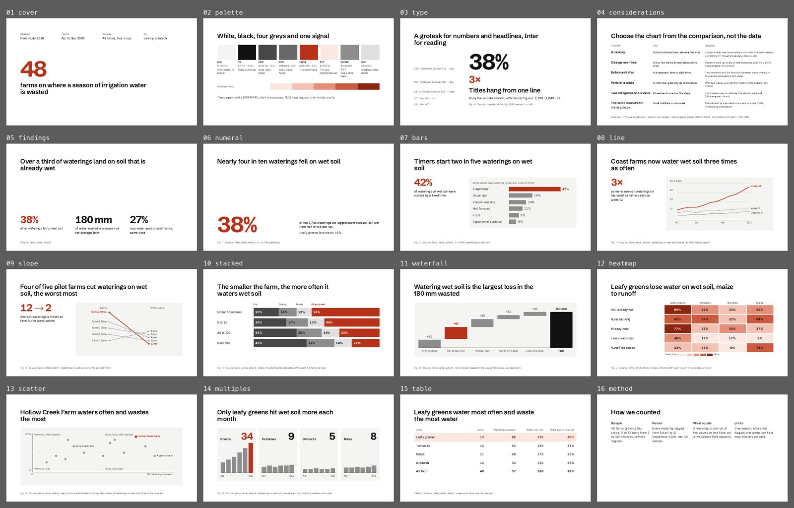

# Grid

Research readouts, interview syntheses, pilot results, metrics reviews and investor updates where the numbers are the point. Not for narrative proposals (use Paper) or the pitch (use Midnight).



The same slides as a deck on claude.ai: https://claude.ai/artifact/5Hpxducircn6zsXrcw4Ter (private to Eun until shared from its Share menu).

## The look

Stark white, black, four greys and one red-orange signal. Headlines in Schibsted Grotesk hang from the same line on every slide; numerals are set huge (100 and 220px); body and labels in Inter with tabular figures. There are no boxes, no radius and no column rules: columns are separated by space, and charts sit on a flat plot fill. Lines appear only inside charts, where they carry data (axes, gridlines, baselines). It borrows the Swiss asymmetric grid and hanging headline (Müller-Brockmann), grey-first charts with one highlight (Datawrapper, IBM Carbon), and the finding-left, chart-right readout with a figure and source line.

## Palette

| Token | Hex | Use | on page | on plot |
|---|---|---|---|---|
| page | `#FFFFFF` | Every slide (stark white on purpose) |  | 1.1 |
| plot | `#F4F4F2` | Chart fields, filled and never outlined | 1.1 |  |
| ink | `#111111` | Titles, numerals, the first column rule | 18.9 | 17.1 |
| ink2 | `#474747` | Body text, data labels, the darkest grey segment | 9.3 | 8.4 |
| ink3 | `#686868` | Axes, notes, footer | 5.6 | 5.1 |
| signal | `#B83219` | The one finding per slide, as a mark or as text | 6.0 | 5.4 |
| tint | `#FBE7E2` | The one highlighted row or cell; first heatmap step | 1.2 | 1.1 |
| context | `#8D8D8D` | Every mark that is not the finding (3.3:1, marks only) | 3.3 | 3.0 |
| grid | `#E0E0E0` | Column rules, gridlines, table rules | 1.3 | 1.2 |
| r2 | `#F4C2B5` | Heatmap step 2 | 1.6 | 1.4 |
| r3 | `#E48E78` | Heatmap step 3 | 2.5 | 2.3 |
| r4 | `#CC5A3E` | Heatmap step 4 | 4.1 | 3.7 |
| r5 | `#8E2410` | Heatmap step 5 (white text) | 8.7 | 7.9 |

Text needs 4.5:1 on its ground (3:1 at 44px and up); colours under 3:1 everywhere are for shapes and fills only.

## Type

Faces: Schibsted Grotesk, Inter, Noto Sans KR (all Google Fonts, declared in `project/deck.json` `faces`). These are the only sizes; a slide should use three of them at most.

| Style | Size | Face | Weight | Line height | Tracking |
|---|---|---|---|---|---|
| numeral | 220px | Schibsted Grotesk | 700 | 0.95 | -9px |
| figure | 100px | Schibsted Grotesk | 700 | 1 | -4px |
| title | 64px | Schibsted Grotesk | 600 | 1.1 | -1.3px |
| body | 30px | Inter | 400 | 1.4 | 0 |
| label | 24px | Inter | 400 | 1.4 | 0 |

## Grid and spacing

1920 × 1080, `padding:144px`; a chart slide gets `padding-bottom:160px` and its figure line at `bottom:64px`. Twelve columns of 114px with 24px gutters in 1632px: four columns are 528px (the finding, row labels), eight are 1080px (the chart), six are 804px (half). Charts sit on the plot fill with 40px padding.

## Rules for this template

- Grey first, then signal on the one mark, cell, number or row the title names. Context marks are #8D8D8D; a second signal never appears.
- Every chart: direct labels, values on bars, unit on the top tick, horizontal gridlines only, no legend unless the labels cannot fit, sorted bars, a zero baseline for bars.
- A figure line under each chart: `Fig. n · Source: who, what, when · n = …`. Slides without data have no footer, and no slide has a page number.
- The heatmap ramp (tint to deep red, five steps) is for heatmaps only; write the value in every cell.
- Tables are built from flex rows, not `<table>`, so they have no grid lines; numbers right-align in tabular figures and one row is tinted.

## Slides

Each slide’s speaker notes start with “Recipe:” and say how to use it; replace them before you present. The numbers are samples: replace each with a sourced one, and fill in any `[bracketed]` source line.

| Slide | What it shows |
|---|---|
| `cover` | Cover: four meta columns, the subject as a 220px numeral, the headline that finishes its sentence |
| `palette` | The palette, with contrast, and the heatmap ramp |
| `type` | The type scale |
| `considerations` | Which chart for which comparison, with sources |
| `findings` | Three findings low on the page |
| `numeral` | One number at 220px with its caption on the same baseline |
| `bars` | Finding left, ranked horizontal bars right |
| `line` | Line chart: one 6px signal series, grey context, labels at the line ends |
| `slope` | Slopegraph: before and after for five items |
| `stacked` | 100% bars with segment names written once above the first bar |
| `waterfall` | Waterfall: floating steps and a total on the baseline |
| `heatmap` | Heatmap with a five-step ramp and values in every cell |
| `scatter` | Positioning map with median lines, quadrant names and four labels at most |
| `multiples` | Small multiples on one scale |
| `table` | Data table from rows, numbers right-aligned, one tinted row |
| `method` | Method: sample, period, definition, limits |
| `close` | Three numbered actions |

## Pink overlay

`overlay-pink.json`: The UI kit's pink as the signal, with a pink heatmap ramp; everything else is Grid. It swaps `#B83219` → `#B23A6E`, `#FBE7E2` → `#FBE6EE`, `#F4C2B5` → `#F7CFDC`, `#E48E78` → `#EBA3C0`, `#CC5A3E` → `#D4709A`, `#8E2410` → `#8A2552`; type, layout and neutrals stay. Run `python3 .claude/skills/oxh-slides/scripts/overlay.py <deck folder> --template grid` on a deck built from this template, then `python3 .claude/skills/oxh-slides/scripts/check.py <deck folder> --template grid --overlay pink`.

## Check

```
python ../../../scripts/check.py . --sample     # this template’s own slides
python ../../../scripts/preview.py .            # contact sheet in preview/
```
