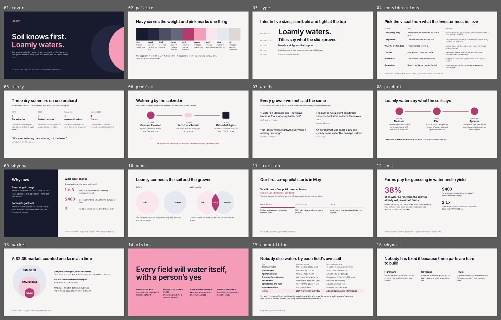

# Midnight

Investor and accelerator decks: the pitch, a fundraising update, demo-day slides. Navy bookends with sakura pink. Not for customer meetings (use Paper) or data readouts (use Grid).



The same slides as a deck on claude.ai: https://claude.ai/artifact/DrQCEQNpXzHw1PV233FoMn (private to Eun until shared from its Share menu).

## The look

Navy bookends and warm off-white pages, Inter alone at five sizes, semibold with tight tracking for titles. The brand mark is two overlapping circles (two groups meeting, the overlap is the company); it sits on the cover, the Venn and the close and nowhere else. Diagrams carry the story: a timeline for the opening, a loop whose shapes change at each hop for the problem, the same loop in pink for the product, a navy and page split for why now. There are no labels above titles, no capitals, no cards, no rules and no page numbers; a source line appears only where a number needs one.

## Palette

| Token | Hex | Use | on page | on navy |
|---|---|---|---|---|
| navy | `#181B2E` | Cover and closing background; titles and strong text on light slides | 15.6 |  |
| navy2 | `#23273F` | The brand mark’s circles on navy | 13.5 | 1.2 |
| page | `#F7F5F3` | Content slide background |  | 15.6 |
| ink2 | `#4B4F63` | Body text on light slides | 7.4 | 2.1 |
| muted | `#656879` | Captions, sources, “before” text | 5.1 | 3.1 |
| pink | `#B23A6E` | The one emphasis on a light slide: a figure, a name, a step number | 5.2 | 3.0 |
| sakura | `#F49CB8` | Pink on navy; the statement slide’s background | 1.9 | 8.3 |
| blush | `#FBE6EE` | The highlighted table row and the users’ circle | 1.1 | 14.3 |
| slate | `#E6E8F0` | Screenshot frames and the developers’ circle | 1.1 | 13.9 |
| rose | `#F7CFDC` | Middle circle of the market diagram | 1.3 | 12.1 |
| rail | `#DDD8D4` | Timeline rails and connectors, the only lines | 1.3 | 12.0 |
| onnavy | `#C3C6D4` | Body text on navy | 1.6 | 10.0 |
| onnavy2 | `#A9ADC0` | Names and details on navy | 2.0 | 7.6 |

Text needs 4.5:1 on its ground (3:1 at 44px and up); colours under 3:1 everywhere are for shapes and fills only.

## Type

Faces: Inter (all Google Fonts, declared in `project/deck.json` `faces`). These are the only sizes; a slide should use three of them at most.

| Style | Size | Face | Weight | Line height | Tracking |
|---|---|---|---|---|---|
| display | 120px | Inter | 600 | 1.04 | -3.5px |
| title | 64px | Inter | 600 | 1.12 | -1.5px |
| heading | 40px | Inter | 600 | 1.2 | -0.8px |
| body | 28px | Inter | 400 | 1.45 | 0 |
| caption | 24px | Inter | 400 | 1.4 | 0 |

## Grid and spacing

1920 × 1080, `padding:128px`; a slide with a source line gets `padding-bottom:160px` and the source at `bottom:64px`. Title to body 72px, columns 72px apart. Titles at most 1500px wide, sentences at most 1000px. The why-now split is a 860px navy panel with the page half from x 972.

## Rules for this template

- One pink thing per light slide; sakura only on navy and on the statement slide, never as text on a light page.
- No labels above titles, no capitals, no letter-spacing on small text, no mono.
- No cards and no rules. Lines only where they carry meaning: the timeline rail, connectors, the phase track.
- A diagram repeats on purpose: the problem loop comes back as the product loop with what the user meant surviving every hop.
- Lead with one hero figure at 120px and let two support it at 64px; never three equal tiles.
- White space at the bottom of a slide is fine. Never add a band, a sentence or a box to fill it.

## Slides

Each slide’s speaker notes start with “Recipe:” and say how to use it; replace them before you present. The numbers are samples: replace each with a sourced one, and fill in any `[bracketed]` source line.

| Slide | What it shows |
|---|---|
| `cover` | Cover: wordmark, the one-liner on two lines with the second in sakura, one sentence, names, the brand mark |
| `palette` | The palette as a strip, with contrast |
| `type` | The type scale: Inter in five sizes |
| `considerations` | Which visual for which pitch moment, with sources |
| `story` | Opening story as a timeline, the turn in pink, one attributed quote |
| `problem` | The loop that fails: the shape changes at each hop, a dashed pink arrow back |
| `words` | What we heard: the question, how we found out, four short lines |
| `product` | The same loop, working: three pink circles |
| `whynow` | A split: what changed on navy, what did not on the page |
| `venn` | The brand mark as the diagram, apart and then overlapping |
| `traction` | One partner, its status and a three-phase track |
| `cost` | One hero figure in pink and two supporting figures |
| `market` | TAM, SAM, SOM as circles on one baseline with the arithmetic |
| `vision` | The sakura statement slide with four principles |
| `competition` | Alternatives as rows in words, our row in blush |
| `whynot` | Three reasons as plain columns |
| `team` | Name, field and what each founder built, then how they know each other |
| `close` | The close: the mark, the one-liner, three thesis lines, names |

## Pink overlay

`overlay-pink.json`: Midnight is the pink look; this overlay changes nothing. Run `python3 .claude/skills/oxh-slides/scripts/overlay.py <deck folder> --template midnight` on a deck built from this template, then `python3 .claude/skills/oxh-slides/scripts/check.py <deck folder> --template midnight --overlay pink`.

## Check

```
python ../../../scripts/check.py . --sample     # this template’s own slides
python ../../../scripts/preview.py .            # contact sheet in preview/
```
