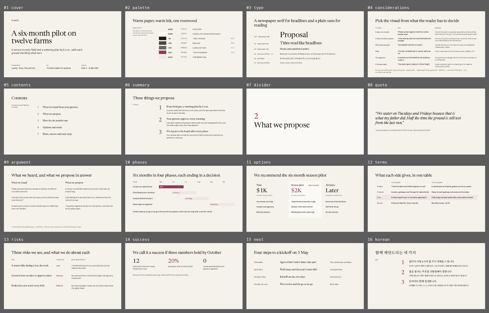

# Paper

Proposals, partner and customer meetings, MoU walk-throughs, narrative updates, and meetings in Korean. It reads like a well-set report: calm, formal, unhurried. Not for numbers-heavy readouts (use Grid).



The same slides as a deck on claude.ai: https://claude.ai/artifact/22s6LWcRcgDXJV6Zc7gbmt (private to Eun until shared from its Share menu).

## The look

Warm paper and warm ink, Newsreader for headlines and figures, Noto Sans KR for reading in English and Korean, Noto Serif KR for Korean headlines. There are no cards and no rules: structure is a 360px margin column for labels and notes, the serif, and space. Rosewood is the only colour with meaning; the sheet tone fills the recommended option and the dividers; wash tints one row. It borrows the editorial margin rail and the Vignelli Canon’s economy of sizes.

## Palette

| Token | Hex | Use | on paper | on sheet |
|---|---|---|---|---|
| paper | `#F5F2EC` | Every slide |  | 1.1 |
| sheet | `#FBF9F5` | Dividers, callouts, the recommended option | 1.1 |  |
| ink | `#1E1C19` | Titles, strong text, the first rule of a group | 15.2 | 16.2 |
| ink2 | `#4A463F` | Body text | 8.4 | 8.9 |
| ink3 | `#6B665D` | Margin labels and notes | 5.1 | 5.4 |
| rose | `#8E3A59` | Rosewood: the one emphasis per slide | 6.5 | 6.9 |
| wash | `#EFE5E4` | The highlighted row or later phases | 1.1 | 1.2 |

Text needs 4.5:1 on its ground (3:1 at 44px and up); colours under 3:1 everywhere are for shapes and fills only.

## Type

Faces: Newsreader, Noto Sans KR, Noto Serif KR (all Google Fonts, declared in `project/deck.json` `faces`). These are the only sizes; a slide should use three of them at most.

| Style | Size | Face | Weight | Line height | Tracking |
|---|---|---|---|---|---|
| display | 120px | Newsreader | 400 | 1.04 | -2px |
| figure | 88px | Newsreader | 400 | 1 | 0 |
| title | 64px | Newsreader | 400 | 1.12 | -0.5px |
| heading | 40px | Newsreader | 400 | 1.25 | 0 |
| body | 28px | Noto Sans KR | 400 | 1.5 | 0 |
| label | 24px | Noto Sans KR | 500 | 1.4 | 0 |

## Grid and spacing

1920 × 1080, `padding:128px`; a slide with footnotes gets `padding-bottom:160px` and the notes at `bottom:64px`. The margin column is 360px with a 64px gap, so the main column starts at x 552 and runs 1240px. Rows are separated by 28 to 40px of space. Nothing is rounded.

## Rules for this template

- One rosewood thing per slide: a figure, a word, the recommended option or a row.
- No boxes and no rules. The sheet tone and the wash are the only fills.
- Serif for anything a reader skims (titles, heads, figures, numbered points); sans for anything they read.
- No running header and no page numbers; a footer appears only for footnotes.
- Korean: same layout, body line height 1.6, headings 1.3 to 1.4, tracking 0, and the company’s name mixed with 귀사 (about a third of the time). Newsreader has no Hangul, so Korean headings fall back to Noto Serif KR by themselves.

## Slides

Each slide’s speaker notes start with “Recipe:” and say how to use it; replace them before you present. The numbers are samples: replace each with a sourced one, and fill in any `[bracketed]` source line.

| Slide | What it shows |
|---|---|
| `cover` | Cover: serif title, a sans line on what the reader gets, three meta columns |
| `palette` | The palette, with contrast |
| `type` | The type scale, with a Korean line |
| `considerations` | Which visual for which decision, with sources |
| `contents` | Contents with numbered parts |
| `summary` | Three numbered points in the margin layout |
| `divider` | Part divider on the sheet tone |
| `quote` | Pull quote in serif italic with role, company type and date |
| `argument` | Two parallel columns: what we heard, what we propose, with footnotes |
| `phases` | Gantt-lite: months as columns, a row per phase, the current phase in rosewood |
| `options` | Three options with the recommended one on the sheet tone |
| `terms` | Terms as rows: what each side gives |
| `risks` | Risks, likelihood in words, what we do about each |
| `success` | Three success figures and how they are measured |
| `next` | Next steps: when, what, who |
| `korean` | The summary in Korean, to copy for Korean decks |
| `close` | The close: the date you want, the one thing to do, how to reach you |

## Pink overlay

`overlay-pink.json`: The UI kit's pink in place of rosewood; everything else is Paper. It swaps `#8E3A59` → `#B23A6E`, `#EFE5E4` → `#FBE6EE`; type, layout and neutrals stay. Run `python3 .claude/skills/oxh-slides/scripts/overlay.py <deck folder> --template paper` on a deck built from this template, then `python3 .claude/skills/oxh-slides/scripts/check.py <deck folder> --template paper --overlay pink`.

## Check

```
python ../../../scripts/check.py . --sample     # this template’s own slides
python ../../../scripts/preview.py .            # contact sheet in preview/
```
