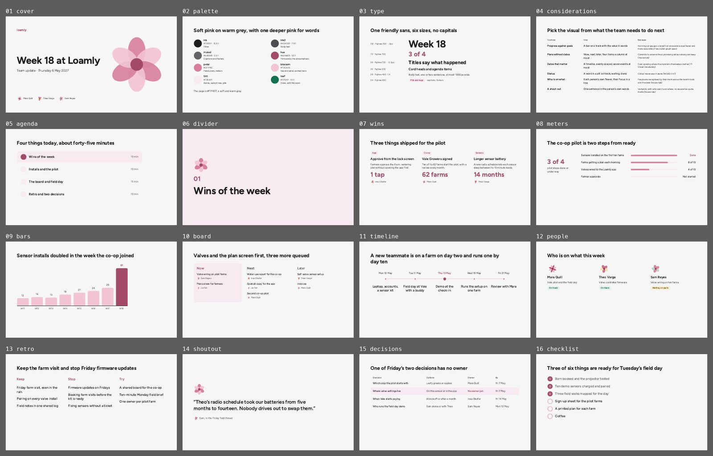

# Petal

Team updates, weekly check-ins, workshops, onboarding, hackathons and anything internal or community-facing that should feel friendly. It is the pink UI kit's light theme on slides. Not for investors or customers who expect formality.



The same slides as a deck on claude.ai: https://claude.ai/artifact/3ERhEvbgXDLXH1EkXGpgs1 (private to Eun until shared from its Share menu).

## The look

A warm grey page, deep pink #A34A69 for words and petal pinks for shapes, Figtree in six sizes, sentence case everywhere and no eyebrows or mono. No cards, no rules and no footers: people, wins and lists are columns separated by space, and the only fills are the tint behind the current agenda item, the Now lane and the unowned decision. A six-petal flower is the only decoration, and each person appears as their own flower, drawn from their name so it is the same every time.

## Palette

| Token | Hex | Use | on page | on tint |
|---|---|---|---|---|
| page | `#F7F6F7` | Every slide |  | 1.1 |
| card | `#FFFFFF` | White: numbers and checks on deep pink | 1.1 | 1.2 |
| ink | `#1D1D1F` | Titles and strong text | 15.6 | 14.5 |
| ink2 | `#4D4D52` | Body text | 7.8 | 7.2 |
| muted | `#636368` | Captions and done items | 5.5 | 5.1 |
| hue | `#A34A69` | Deep pink: the only pink for words, filled dots, the current item | 5.2 | 4.8 |
| petal | `#D77F9C` | Petals, bars, meter fills (shapes only) | 2.6 | 2.4 |
| blossom | `#F2C4D3` | Second petal, context bars, the timeline rail (shapes only) | 1.4 | 1.3 |
| tint | `#F8EAF1` | Section and closing backgrounds, the current row, pills | 1.1 |  |
| leaf | `#11704F` | “Done” or “on track”, always with the word | 5.6 | 5.2 |
| leafwash | `#E3F0EA` | Behind leaf text in a pill | 1.1 | 1.0 |
| amber | `#7F5C00` | “Waiting”, always with the word | 5.7 | 5.3 |
| amberwash | `#F6EEDA` | Behind amber text in a pill | 1.1 | 1.0 |

Text needs 4.5:1 on its ground (3:1 at 44px and up); colours under 3:1 everywhere are for shapes and fills only.

## Type

Faces: Figtree (all Google Fonts, declared in `project/deck.json` `faces`). These are the only sizes; a slide should use three of them at most.

| Style | Size | Face | Weight | Line height | Tracking |
|---|---|---|---|---|---|
| display | 112px | Figtree | 700 | 1.05 | -2px |
| figure | 72px | Figtree | 700 | 1.05 | 0 |
| title | 56px | Figtree | 700 | 1.18 | -0.5px |
| heading | 36px | Figtree | 600 | 1.25 | 0 |
| body | 28px | Figtree | 400 | 1.4 | 0 |
| label | 24px | Figtree | 600 | 1.4 | 0 |

## Grid and spacing

1920 × 1080, `padding:128px`. Title to body 56 to 64px. Columns 72px apart; rows 20 to 32px apart. Pills are 24px semibold on the tint with 8px 20px padding.

## Rules for this template

- Deep pink is the only pink for text; petal and blossom are for shapes, bars and the flower.
- No cards and no rules; a tint fill marks the one current or open thing.
- Leaf green and amber mean done and waiting, always with the word in the pill.
- No footers and no page numbers in a team deck.
- People are shown as their own flowers, never initials or stock avatars: `python3 .claude/skills/oxh-slides/scripts/flower.py "Mara Quill" 96` prints the SVG for a name (`--hub` prints the six-petal mark instead).

## Slides

Each slide’s speaker notes start with “Recipe:” and say how to use it; replace them before you present. The numbers are samples: replace each with a sourced one, and fill in any `[bracketed]` source line.

| Slide | What it shows |
|---|---|
| `cover` | Cover: the flower large on the right, the meeting’s name, everyone’s own flower |
| `palette` | The palette, with contrast |
| `type` | The type scale |
| `considerations` | Which visual for which team need, with sources |
| `agenda` | Agenda with progress: the current item tinted |
| `divider` | Section divider on the tint |
| `wins` | Three wins: area pill, what changed, the figure, the owner |
| `meters` | Progress meters against goals |
| `bars` | One-series bar chart with the latest bar in deep pink |
| `board` | Now, next, later with owners; only Now is tinted |
| `timeline` | Timeline with evenly spaced dates |
| `people` | Who is on what: own flowers, focus, status pills |
| `retro` | Keep, stop, try |
| `shoutout` | A shout-out in someone’s own words |
| `decisions` | Decisions as rows with the unowned row tinted |
| `checklist` | Checklist with done items stepped back |
| `close` | The close: the next date and what to do before it |

## Pink overlay

`overlay-pink.json`: Petal is already the UI kit's pink; this overlay changes nothing and exists so every template takes the same flag. Run `python3 .claude/skills/oxh-slides/scripts/overlay.py <deck folder> --template petal` on a deck built from this template, then `python3 .claude/skills/oxh-slides/scripts/check.py <deck folder> --template petal --overlay pink`.

## Check

```
python ../../../scripts/check.py . --sample     # this template’s own slides
python ../../../scripts/preview.py .            # contact sheet in preview/
```
