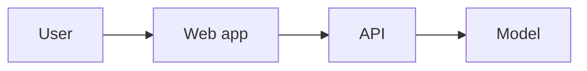

# <Name>: spec and build plan

Draft · <date> · Owners: <who owns what>

**Pitch line.** <We built X so that Y can Z.>

## The user

<One named person or role.> Today they <what they do>, which takes <time or pain, sourced>. In their words: "<quote>".

## Demo beats

| Time | On screen | The judge understands |
| --- | --- | --- |
| 0:00 | | |

Live or video: <which, and the fallback>.

## Outcomes

| # | Outcome | How we'll know | Status |
| --- | --- | --- | --- |
| O1 | | | |

## The riskiest unknown

<What could sink the demo.> Spike: <what we try first, in under an hour, and what result means go>.

## Build order

| # | Work | Size | Owner | Needs | In the demo? |
| --- | --- | --- | --- | --- | --- |
| 1 | Spike: <the unknown> | S | | | |

Sizes: S under 2 h, M 2 to 5 h, L over 5 h. Critical path: <sum> of <hours to the freeze>.

## Architecture

### Contracts

| Between | Interface | Example | Test |
| --- | --- | --- | --- |
| web → api | `POST /api/...` | `{...}` | |

## Data

| Dataset | Source | Licence | Lives in | Credit line |
| --- | --- | --- | --- | --- |

## Rules that stay

- Every number on screen comes from a run, never from the model's prose.
- Data and keys stay out of git.

## Cut list

| If by | We haven't | We cut |
| --- | --- | --- |

## Cut

What was cut, when, and why.
